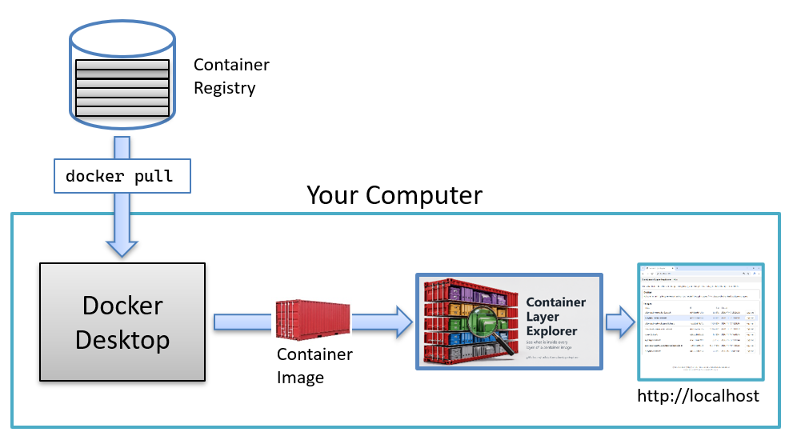
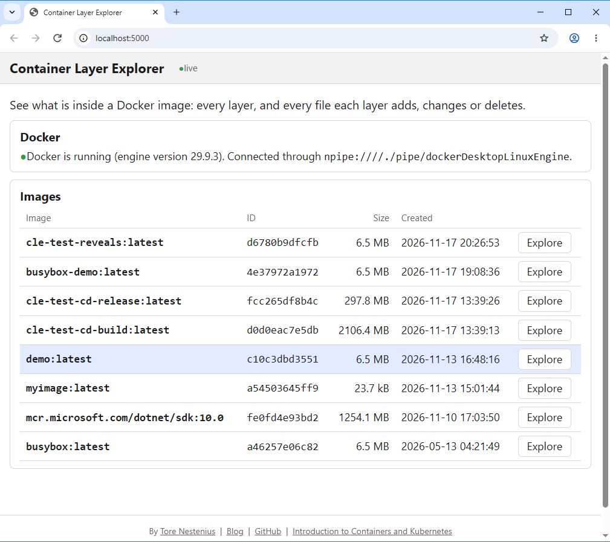
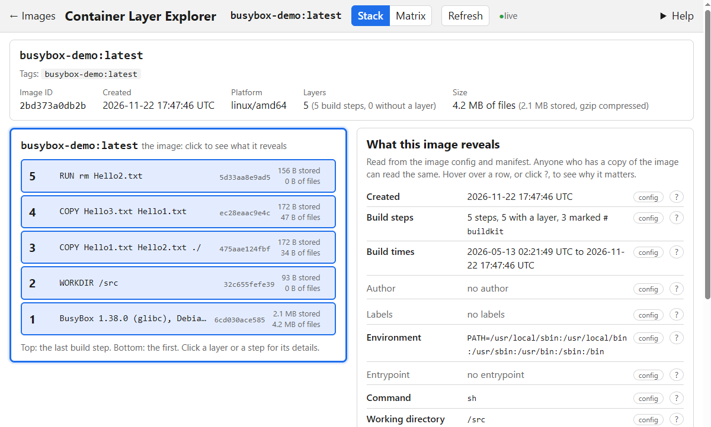

# Container Layer Explorer

[](https://github.com/tndata/ContainerLayerExplorer/actions/workflows/build-and-test.yml)
[](LICENSE)

Container Layer Explorer is a local web app that shows every layer of a Docker or OCI image and what each build step adds, changes or deletes. You see the layers as a matrix of file paths and as a stack, together with what the image config and manifest reveal. The view updates when you rebuild the image.

When I teach containers, I notice that developers use images every day, but the layered file system inside them is often a challenge to grasp. The same questions keep coming up:

- Which files end up in which layer?
- What happens when I delete a file in a later step?
- What affects the final image size?

I built Container Layer Explorer to make that visible, so you get a clear mental model of how the layers are stacked on top of each other and merged into the one file system that a container sees. This is the idea behind a union file system. I also use it in my own training, for example in my course [Introduction to Containers and Kubernetes](https://tn-data.se/courses/introduction-to-containers-and-kubernetes/).

The diagram below shows the general setup:



## Requirements

I have tested the tool in the following setup:

- Windows with [Docker Desktop](https://www.docker.com/products/docker-desktop/), running.
- Docker Desktop in Linux containers mode (the default).
- The [.NET 10 SDK](https://dotnet.microsoft.com/download).

There are no binary releases. You build and run the tool from source.

I have not tested other setups, such as Linux, macOS or other container engines. Help to support and verify them is welcome, so get in touch or send a pull request.

## Quick start

1. Start Docker Desktop. Then get the source code and run the tool:

   ```bash
   git clone https://github.com/tndata/ContainerLayerExplorer.git
   cd ContainerLayerExplorer
   dotnet run --project src/ContainerLayerExplorer
   ```

2. When the terminal shows `Now listening on: http://localhost:5000`, open <http://localhost:5000> in your browser. Leave that terminal running. The tool stops when you press Ctrl+C or close the terminal.

3. In another terminal, make an empty folder with a text file called `Hello.txt` (any text) and a `Dockerfile`:

   ```dockerfile
   FROM scratch
   COPY Hello.txt /
   ```

   This Dockerfile starts from `scratch`, the empty image, and copies `Hello.txt` into the root of the image. The result is an image with a single layer.

4. Build it from that folder:

   ```bash
   docker build -t demo .
   ```

   Docker adds the default tag, so the image is called `demo:latest`.

5. On the start page, find `demo:latest` and choose **Explore**. The Matrix view shows one layer column and its one file. Switch to **Stack** to see the same layer drawn as a stack.

   

6. Keep the page open. Add a line to the Dockerfile:

   ```dockerfile
   FROM scratch
   COPY Hello.txt /
   COPY Hello.txt /Hello2.txt
   ```

   The new line copies the same `Hello.txt` again, this time as `/Hello2.txt`. That adds a second layer on top of the first one.

   Then build again with the same command:

   ```bash
   docker build -t demo .
   ```

   The page updates by itself. The second layer gets a NEW badge, because its content was not in the image you had open. The first layer has the same content as before, so it gets no badge.

## Try the sample

The folder [samples/busybox-basics](samples/busybox-basics) holds a small image built on `busybox:1.38.0-glibc` that shows all three kinds of change: added, changed and deleted.

1. With the tool running, open a terminal in the folder of this repository and build the sample. It makes an image called `busybox-demo:latest`:

   ```bash
   docker build -t busybox-demo samples/busybox-basics
   ```

2. On the start page, find `busybox-demo:latest` and choose **Explore**. The Matrix view shows the five layers as columns, BusyBox in layer 1. Look at the `/src` folder:
   - `Hello1.txt` is added in layer 3 (A) and changed in layer 4 (M). Click the M cell: the layer stores the whole new file, and the old version is still stored in layer 3.
   - `Hello2.txt` is added in layer 3 and deleted in layer 5 (D). Click the D cell: layer 5 only holds a marker file, `.wh.Hello2.txt`, that hides it. Click **Show it** to see the file's content, still stored in layer 3.
   - The Result cell of `Hello2.txt` is empty. A container started from this image does not get the file, but anyone with a copy of the image can still read it.
3. Switch to **Stack** to see the same five layers drawn as a stack, BusyBox at the bottom, and what the image reveals. Click a layer for its details.
4. Keep the page open. Add a line at the end of the `Dockerfile`, for example `COPY Hello3.txt Hello4.txt`, and run the same command again:

   ```bash
   docker build -t busybox-demo samples/busybox-basics
   ```

   The page updates by itself. The new layer gets a NEW badge. The five layers below it have the same content as before, so they get none.

## How it works

Container Layer Explorer runs on your own computer, next to Docker Desktop, and works only with the images in your local Docker. The basic steps are:

1. **Get an image into Docker.** First, you need a container image in Docker Desktop. You can either build one locally from a Dockerfile or pull one from a registry, such as Docker Hub.
2. **Start Container Layer Explorer.** Run the tool (see [Quick start](#quick-start)). When the terminal shows `Now listening on`, open `http://localhost:5000` in your browser.
3. **Open an image.** The start page lists the tagged images in your local Docker. Choose one, and the tool exports it from Docker through the Docker Engine API (the same export as `docker save`) and reads its layers, config and manifest.
4. **Explore the layers.** See the image as a matrix of files and layers, or as a stack of layers.
5. **Rebuild and watch it update.** The tool listens to Docker's image events, so when you build, tag or remove an image, the page updates by itself.

The tool changes nothing in Docker. It never starts a container, and it never pushes, pulls, deletes or changes an image. To read an image it does write a copy to your disk, see [Trust and responsibility](#trust-and-responsibility).

## The two views

An image can be shown in two ways, and you switch between them with the **Stack | Matrix** toggle at the top of the page. An image opens in the Matrix view.

### The Matrix view


- **Paths and layers.** One row per file or folder, one column per layer. Each cell shows if the layer added (A), changed (M) or deleted (D) that path. M means the layer wrote the path again; the contents are not compared.
- **The result.** The Result column shows the final file system, which is what a container gets. A deleted file is only hidden: its data is still stored in the layer below, so the image does not get smaller.
- **File contents.** Click a cell to see what the layer did to that path, and the content of a text file in that layer.
- **Build steps.** Each column shows the Dockerfile step behind the layer, taken from the build history stored in the image. Click the column header for the full command.
- **Large images.** Top-level folders start collapsed, and a filter box narrows the list.

### The Stack view



- **The image as a stack.** The Stack view draws the layers bottom to top, the first build step at the bottom. Each layer shows its build command, a short layer ID and two sizes:
  - *compressed*: the size of the layer as it is stored in Docker's export of the image, usually gzip-compressed. This is roughly what a push or a pull transfers.
  - *of files*: the sizes of the files in the layer's file list added up, uncompressed. A deleted file counts as 0 B here, because the layer only holds its marker.

  Steps that make no layer, such as `ENV` and `LABEL`, are thin 0 B rows. Above the stack are the image's tags, image ID, creation time, platform, the number of layers and build steps, and the same two sizes for the whole image (*of files* and *stored, compressed*). The files figure adds up every layer, including files that later layers change or delete, so it differs from the size on the start page, which is Docker's own figure.
- **What an image reveals.** With the image selected, the right side lists what anyone with a copy of the image can read from its config and manifest: creation time, build steps, author, labels, environment variables, user, ports, volumes, health check and more. Each row says where the fact comes from, and an empty row says what is missing.
- **Layer details.** Click a layer in the stack for its details: the build step and its time, both fingerprints (content and stored blob), the sizes and compression, what it adds, changes and deletes, its biggest files, how much of its data later layers hide, and permission facts such as setuid programs and world-writable folders. A step without a layer can be clicked too.

### In both views

- **Live update.** While the explorer page is open, it follows its tag. When the tag points to a new image, for example after a rebuild, the page loads it, and each layer whose content digest was not in the image shown before gets a NEW badge. A layer with the same content as before gets no badge, whether Docker took it from the build cache or built it again with the same result. The badges only compare with what the open page showed: when you reload the page, they are gone.
- **A start page.** It lists the tagged images in your local Docker, one row per tag, updates live, and shows a message when it cannot reach Docker.

## Troubleshooting

### The page does not open

Look in the terminal where the tool runs. When it is ready, it shows `Now listening on: http://localhost:5000`. If it shows `address already in use` instead, another program, or another copy of the tool, already uses port 5000. Stop that program, or start the tool on another port and open that address instead:

```bash
dotnet run --project src/ContainerLayerExplorer --urls http://localhost:5050
```

### The page cannot reach Docker

Start Docker Desktop and wait until it is running. Then run `docker version` in a terminal. Its output must have a `Server` section. If it only shows `Client`, the Docker engine is not running, and the tool cannot reach it either. The page updates by itself when Docker is back.

### An image is missing from the start page

The start page lists tagged images only. An image you built without `-t` has no tag, so give it one: `docker tag <image ID> myimage`.

The image must also be in the Docker engine that the tool talks to. The start page shows which one, after "Connected through". The tool does not follow `docker context`: it uses the `DOCKER_HOST` environment variable when it is set, and otherwise Docker Desktop's own connection. An image in a registry has to be pulled first, see the [FAQ](#can-i-look-at-an-image-from-docker-hub-or-another-registry).

### An image is too large, or only partly shown

Two limits in `src/ContainerLayerExplorer/appsettings.json` protect your computer:

- `MaxImageSizeMb` (4096 by default). Before it exports an image, the tool compares the size that Docker reports for it with this limit. A bigger image is not opened, and the page shows its size and the limit. The tool also checks that the temp folder's drive has room for the image.
- `MaxEntries` (200,000 by default). The tool reads at most this many file entries, counted over all layers from the bottom up. When it reaches the limit, it stops reading, opens the image anyway, and shows "Too many files: only the first part is shown." The layers after that point show no changes, and the sizes are too small.

You can change both values under `Limits` in `appsettings.json`. Start the tool again afterwards. It does not start if a value is out of range (1 to 1,000,000 MB, and 1 to 100,000,000 entries).

## Learn more

<!-- TODO at go-live: link the post, https://nestenius.se/net/how-container-images-work-container-layer-explorer/ -->
- I teach containers in my course [Introduction to Containers and Kubernetes](https://tn-data.se/courses/introduction-to-containers-and-kubernetes/).

## Trust and responsibility

- It only reads from Docker. It never starts a container, and it never changes, deletes, pushes or pulls an image.
- It can show the contents of files inside an image, and those files can include secrets.
- It writes to your disk. To open an image, it exports it from Docker into a folder under your temp folder (on Windows, `%TEMP%\ContainerLayerExplorer`) and keeps the last six images there while it runs. That copy holds everything in the image, so it can contain sensitive files. The folder is removed when the tool shuts down normally. If the tool was stopped abruptly, the folder stays until a later start, which removes unused folders that are more than a day old.
- It listens on `http://localhost:5000` by default, rejects requests with any other host name, and has no sign-in. Do not expose it on a network.
- There are no binary releases. You build it from source.

See [SECURITY.md](SECURITY.md) for how to report a security problem.

## FAQ

### What is the difference between Docker, container and OCI images?

- **Container image** is the general term: an application and the file system it needs, packed as a stack of layers, plus the settings for starting it.
- **Docker image** and **OCI image** are two closely related formats for container images. The [OCI Image Specification](https://github.com/opencontainers/image-spec) is the open standard from the [Open Container Initiative](https://opencontainers.org/). Docker's own format is described in the [Docker Image Manifest V2, Schema 2](https://distribution.github.io/distribution/spec/manifest-v2-2/) specification, and Docker donated its container format to the initiative as the starting point.
- **What this tool opens:** both formats, as long as the image is in your local Docker. Images with zstd-compressed layers are not supported yet.

### Does the tool start or change my containers?

No. It never starts a container, and it never pushes, pulls, deletes or changes an image. See [Trust and responsibility](#trust-and-responsibility) for what it writes to your disk.

### Does it work on Linux or macOS?

I have not tested it there, see [Requirements](#requirements). If you try it, I would like to hear how it went, see [Contributing](#contributing).

### Does it support other container engines?

I have only tested it with Docker Desktop, see [Requirements](#requirements). Podman and Rancher Desktop (with its dockerd engine) offer a Docker-compatible API, so they may work, but I have not tried them. A report or a pull request is welcome.

### Can I look at an image from Docker Hub or another registry?

Yes, but not directly. The tool can only show the images in your local container engine (Docker Desktop), and it never connects to a registry itself. To look at an image from Docker Hub or another registry, first pull it into Docker Desktop, for example with `docker pull`. It then shows up on the start page.

### Is it free?

Yes. It is open source under the [MIT licence](LICENSE).

## Contributing

Contributions are welcome, see [CONTRIBUTING.md](CONTRIBUTING.md).

- To report a bug, use the [bug report](https://github.com/tndata/ContainerLayerExplorer/issues/new?template=bug_report.md) template.
- To suggest an idea, use the [feature request](https://github.com/tndata/ContainerLayerExplorer/issues/new?template=feature_request.md) template.
- If you try the tool on another operating system or with another container engine, open an issue and tell me your operating system, the Docker engine and its version, the steps you took, and what worked and what did not.
- Report a security problem privately, as described in [SECURITY.md](SECURITY.md), not in a public issue.

## About the author

Container Layer Explorer was developed by [Tore Nestenius](https://nestenius.se/), a Microsoft .NET MVP and independent consultant and trainer from Göteborg, Sweden, specializing in authentication, identity and security in .NET.

* [LinkedIn](https://www.linkedin.com/in/torenestenius/)
* [Blog](https://nestenius.se/)
* [Company](https://tn-data.se/)

## Other open-source projects by the author

- [Coding Agent Explorer](https://github.com/tndata/CodingAgentExplorer): real-time .NET proxy and dashboard for inspecting AI coding agent API calls (currently supports Claude Code).
- [CloudDebugger](https://github.com/tndata/CloudDebugger): open-source tool to explore and troubleshoot Azure from .NET: App Service, storage, messaging, identity and DefaultAzureCredential.

More on [GitHub](https://github.com/tndata).

## License

[MIT](LICENSE)

## Trademarks

Docker and the Docker logo are trademarks or registered trademarks of Docker, Inc. in the United States and/or other countries. Docker, Inc. and other parties may also have trademark rights in other terms used herein.

Kubernetes is a registered trademark of The Linux Foundation.

Microsoft, Windows and .NET are trademarks of the Microsoft group of companies.

Container Layer Explorer is an independent project. It is not affiliated with, endorsed by or sponsored by Docker, Inc., Microsoft or any other owner of the trademarks named here.
