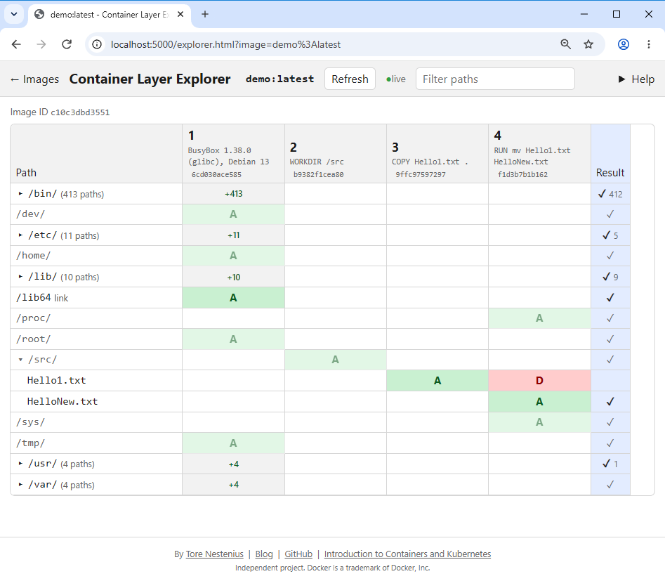

# Container Layer Explorer

[](https://github.com/tndata/ContainerLayerExplorer/actions/workflows/build-and-test.yml)
[](LICENSE)

Container Layer Explorer is a local web tool for exploring Docker and OCI image layers. It shows which files each layer of a container image adds, changes or deletes, as a matrix of file paths and layers, and it updates automatically when you rebuild the image.

<!-- TODO (CLE-12): take this screenshot before the README is pushed: the matrix of an image with a few layers, one deleted cell and the NEW badge visible. -->


## Why I built it

When I teach containers, one challenge is to present image building in an intuitive way and to give students the right mental model of what happens. So I created this tool to visualize it. You see every layer of an image and what each build step adds, changes or deletes, and the view updates when you rebuild. I use it in my container training, and I have decided to open source it.

## What it shows

- **Live update.** Build or rebuild an image and the page follows it. A layer that is new since your previous build gets a NEW badge, and the layers that came from the build cache do not.
- **A matrix of paths and layers.** One row per file or folder, one column per layer. Each cell says if the layer added (A), changed (M) or deleted (D) that path.
- **How deletions work.** A deleted file is only hidden by a whiteout marker in a later layer. The file is still in the layer below, so the image does not get smaller. The tool shows that.
- **File contents.** Click a cell to see what the layer did to that path and, for a text file, its content in that layer.
- **The build steps.** Each layer column shows the Dockerfile step behind it. Click the column header for the full command and the steps that make no layer, such as `ENV` and `CMD`.
- **Large images.** The folders directly under `/` start collapsed into one summary row each, with the number of paths and what each layer adds, changes or deletes in them. Expand what you want to look at. A filter box narrows the paths.
- **A start page.** It lists the images in your local Docker, updates live, and shows a message when Docker is not running.

## Requirements

- The [.NET 10 SDK](https://dotnet.microsoft.com/download) or newer
- [Docker Desktop](https://www.docker.com/products/docker-desktop/), running

## Quick start

1. Start Docker Desktop, then run the tool from source:

   ```bash
   git clone https://github.com/tndata/ContainerLayerExplorer.git
   cd ContainerLayerExplorer
   dotnet run --project src/ContainerLayerExplorer
   ```

   Your browser opens at <http://localhost:5000>.

2. In another terminal, make an empty folder with a text file called `Hello.txt` (any text) and a `Dockerfile`:

   ```dockerfile
   FROM scratch
   COPY Hello.txt /
   ```

3. Build it:

   ```bash
   docker build -t demo .
   ```

4. In the tool, pick `demo` and choose **Explore**. You see one layer with one file.

5. Add a line to the Dockerfile and build again:

   ```dockerfile
   FROM scratch
   COPY Hello.txt /
   COPY Hello.txt /Hello2.txt
   ```

   The page updates by itself. The new layer has a NEW badge, and the first one does not.

The tests do not need Docker: `dotnet test`.

## What was tested

I test the tool on Windows with Docker Desktop. The unit tests also run on Linux in GitHub Actions. The tool can also talk to Docker through a Unix socket, but I have not tried Linux or macOS, so I do not claim that they work.

## Trust and responsibility

- It reads images from your local Docker. It never pushes, pulls, deletes or changes an image, and it never starts a container.
- It can show the contents of files inside an image, and those files can include secrets. Use it on images you are allowed to open.
- It listens on `localhost` only and has no sign-in. Do not expose it on a network.
- There are no binary releases. You build it from source.

See [SECURITY.md](SECURITY.md) for how to report a security problem.

## Learn more

I teach containers in my course [Introduction to Containers and Kubernetes](https://tn-data.se/courses/introduction-to-containers-and-kubernetes/).

## Contributing

Contributions are welcome, see [CONTRIBUTING.md](CONTRIBUTING.md).

## About the author

Container Layer Explorer was developed by [Tore Nestenius](https://nestenius.se/), a Microsoft .NET MVP and independent consultant and trainer from Göteborg, Sweden, specializing in authentication, identity and security in .NET.

* [LinkedIn](https://www.linkedin.com/in/torenestenius/)
* [Blog](https://nestenius.se/)
* [Company](https://tn-data.se/)

## Other open-source projects by the author

- [Coding Agent Explorer](https://github.com/tndata/CodingAgentExplorer): real-time .NET proxy and dashboard for inspecting AI coding agent API calls (currently supports Claude Code).
- [CloudDebugger](https://github.com/tndata/CloudDebugger): open-source tool to explore and troubleshoot Azure from .NET: App Service, storage, messaging, identity and DefaultAzureCredential.

More on [GitHub](https://github.com/tndata).

## License

[MIT](LICENSE)

## Trademarks

Docker and the Docker logo are trademarks or registered trademarks of Docker, Inc. in the United States and/or other countries. Docker, Inc. and other parties may also have trademark rights in other terms used herein.

Kubernetes is a registered trademark of The Linux Foundation.

Microsoft, Windows and .NET are trademarks of the Microsoft group of companies.

Container Layer Explorer is an independent project. It is not affiliated with, endorsed by or sponsored by Docker, Inc., Microsoft or any other owner of the trademarks named here.
